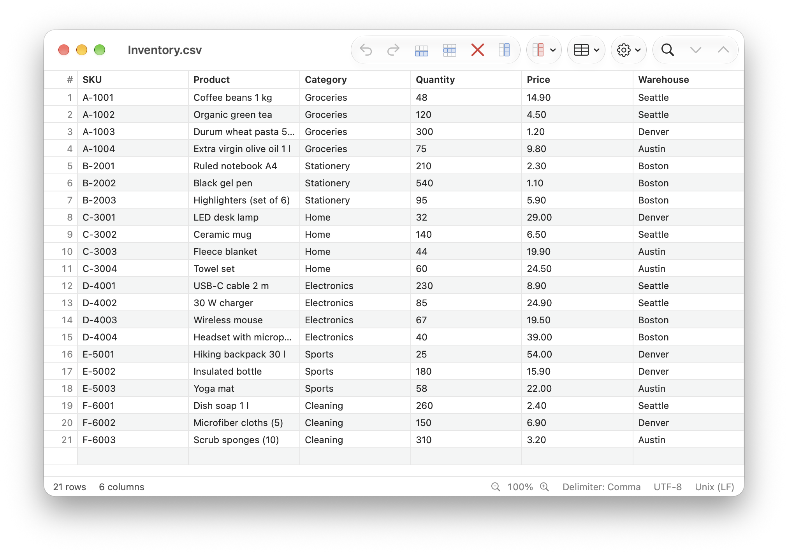
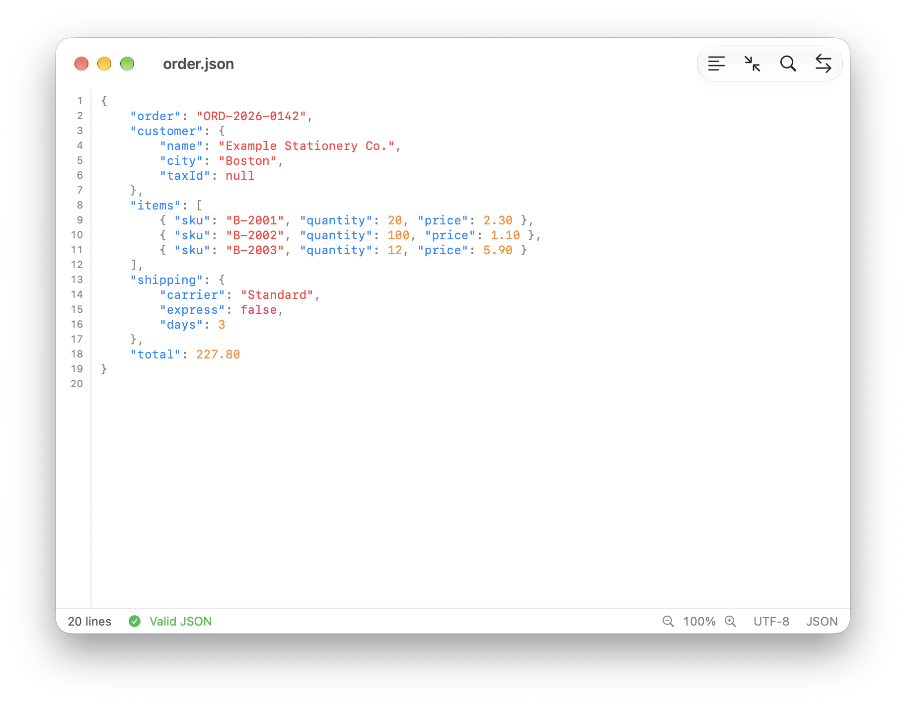
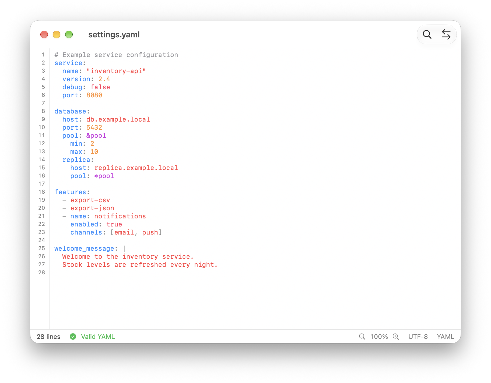

# fil's editor

A native CSV editor for macOS, written in SwiftUI.

It started as a way to open and edit CSV files like a spreadsheet, without going through Excel or
Numbers and without altering the file: the delimiter, line endings, encoding and BOM are detected
when the file is opened and written back unchanged when it is saved.



## Features

### CSV / TSV — stable
- Spreadsheet-style grid that stays smooth with large files.
- Keyboard cell editing (Return, or just start typing), arrow keys to move, ⇧ to extend the selection.
- Insert, duplicate and delete rows; insert, rename, move and delete columns.
- Sort by column (numbers before text, empty cells at the bottom).
- Find and replace, with a "show only matching rows" filter.
- Copy and paste cell ranges, compatible with Excel and Numbers (tab-separated text).
- Undo and redo for every change.
- Delimiter (comma, semicolon, tab, pipe), line endings (CRLF, LF, CR) and "first row as header"
  can be changed from the Options menu.
- Encodings: UTF-8 (with or without BOM), UTF-16, Windows-1252, ISO Latin-1.
- Grid zoom (⌘+ / ⌘− / ⌘0 or trackpad pinch).

### Excel (.xlsx) — beta
- Opens workbooks read-only, with a sheet picker.
- To keep your changes, use "Save As…" and choose CSV or TSV: the original .xlsx file is never overwritten.

### JSON — beta
- Text editor with line numbers, syntax highlighting and zoom.
- Validation as you type, showing the line and column of the error (click the error to jump to it).
- Format (⇧⌘F) and Minify (⌥⇧⌘F) without reordering keys.



### YAML — beta
- The same editor as JSON, for `.yaml` and `.yml` files.
- Syntax highlighting: keys, strings, numbers, comments, anchors and aliases, tags, `|` and `>` blocks.
- Validation as you type: syntax errors, tabs in indentation, undefined aliases, duplicate keys.
- No automatic reformatting, so comments are never lost.



Beta features are usable but less tested than CSV editing: please report any problems in Issues.

## Requirements

- macOS 26.4 or later.
- To build: Xcode 26 or later.

## Building

Open `fil's editor.xcodeproj` in Xcode and run the "fil's editor" scheme.
Swift Package Manager dependencies are fetched automatically.

From the command line:

```sh
xcodebuild -project "fil's editor.xcodeproj" -scheme "fil's editor" -configuration Release build
```

## Dependencies

- [CoreXLSX](https://github.com/CoreOffice/CoreXLSX) to read Excel files.
- [Yams](https://github.com/jpsim/Yams) to validate YAML files.

## License

Copyright (C) 2026 filp97

fil's editor is free software, released under the [GNU General Public License version 3](LICENSE).
You may use, study, modify and redistribute it, provided that every distributed version, modified
or not, stays under GPL-3.0 with its source code available.
